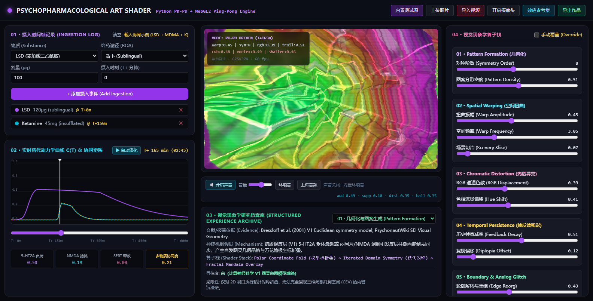
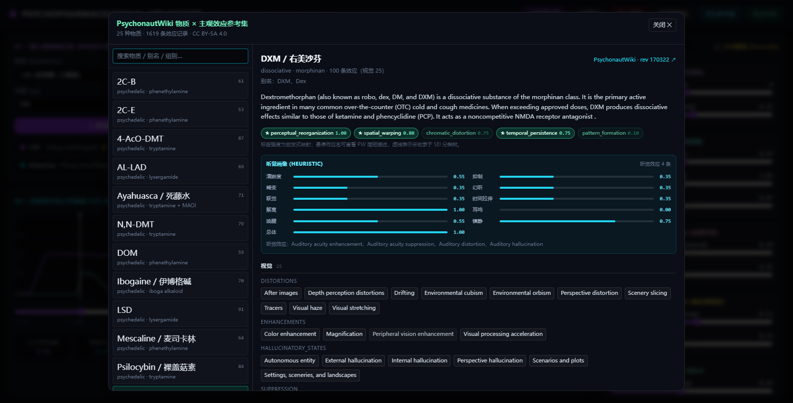
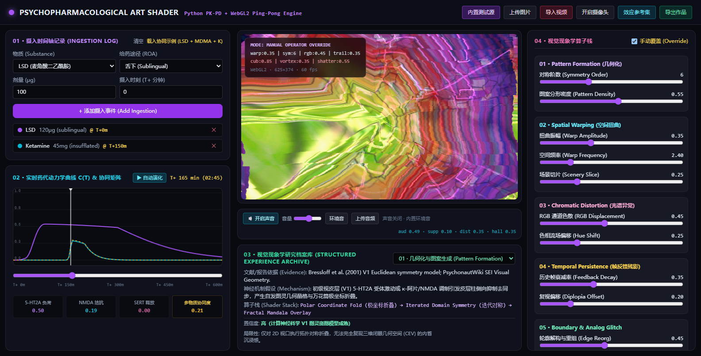
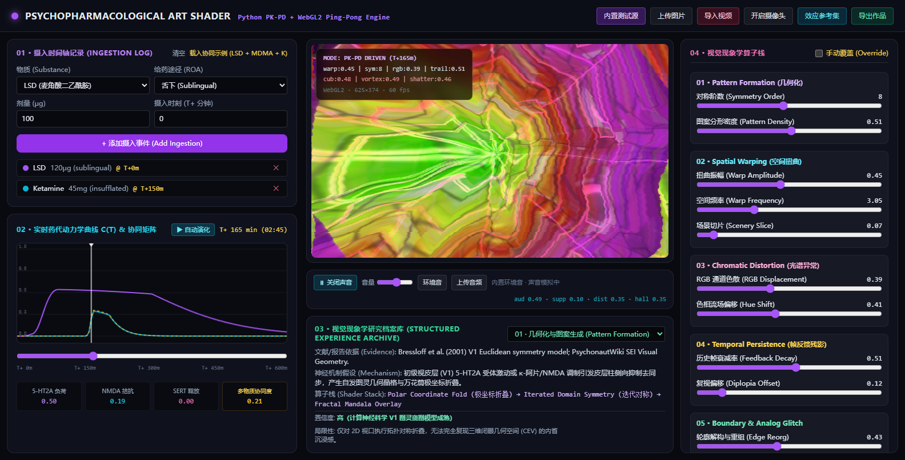
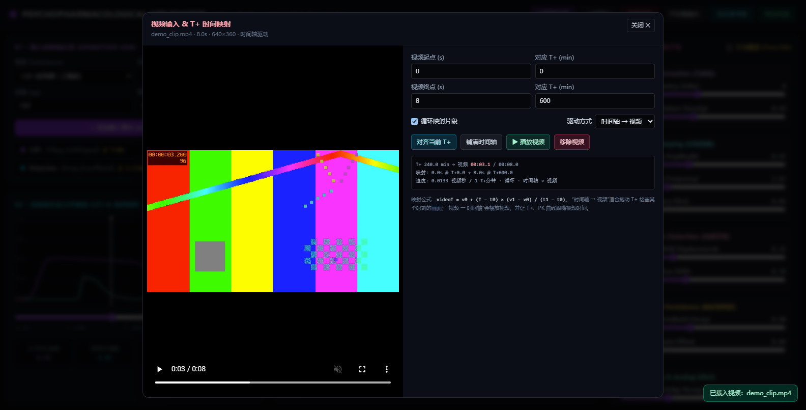
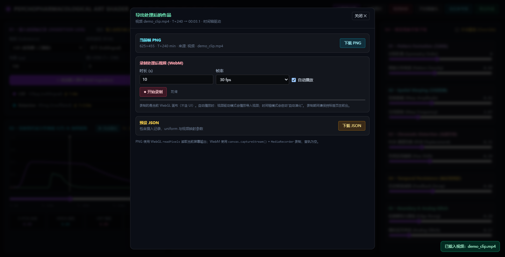

# Psychopharmacological Art Shader Lab

以精神药理学 PK-PD 为参数系统、以视觉心理学为表现语言的艺术着色器实验台。

- **后端**：FastAPI + Pydantic，负责摄入事件 → 血药/效应包络 → Hill 方程 → 受体负载 → 协同矩阵 → GLSL uniform 参数。
- **前端**：原生 WebGL2 双缓冲 ping-pong 渲染管线，把 6 组 / 14 个视觉现象学算子实时映射到画面上（含空间立体主义、漩涡隧道、Voronoi 碎片化）。
- **视听模拟**：Web Audio 环境音 / 上传音频，经听觉画像驱动的滤波、失真、延迟、幽灵音与耳鸣处理，并用音频能量调制画面。
- **参考集**：从 PsychonautWiki 整理的 25 种物质 / 1,619 条主观效应记录，可独立浏览或供 API 查询。
- **可模拟物质**：25 种物质、8 类受体与多组别协同（5-HT2A / NMDA / SERT / D2 / DA-NE / CB1 / KOR / GABA）。
- **无构建步骤**：前端不需要打包器，Tailwind 运行时已本地化，离线可用。

> 这是一个艺术转译 / 计算神经科学可视化项目，不是医学工具，不构成任何用药建议。



---

## 快速开始

要求：Python 3.10+（已在 Python 3.13.5 上验证）。

```powershell
cd E:\psychopharm_shader_lab

# 1. 创建虚拟环境
python -m venv .venv

# 2. 安装依赖（直接调用 venv 里的 python，避免 PowerShell 执行策略问题）
.\.venv\Scripts\python.exe -m pip install -r requirements.txt

# 3. 启动
.\.venv\Scripts\python.exe app.py
```

打开 <http://127.0.0.1:8000>。若 8000 被其他进程占用，使用：

```powershell
.\.venv\Scripts\python.exe app.py --port 8010
```

可选参数：

```powershell
.\.venv\Scripts\python.exe app.py --port 8010
.\.venv\Scripts\python.exe app.py --reload      # 开发模式，监听项目目录
uvicorn app:app --reload                        # 等价的标准 uvicorn 用法
```

`app.py` 内部使用基于 `__file__` 的绝对路径，因此从任意工作目录启动都不会再出现
`Directory 'static' does not exist`。

---

## 目录结构

```
psychopharm_shader_lab/
├─ app.py                    # FastAPI 入口 / 路由 / 参数边界
├─ pk_pd_engine.py           # PK-PD 模型：包络、Hill、协同、uniform 映射
├─ archives.py               # 物质药理数据库 + 视觉现象学档案
├─ reference_library.py      # PsychonautWiki 效应参考集加载层
├─ audio_profiles.py         # 视听效应画像 + 音频参数混合
├─ requirements.txt          # 运行时依赖
├─ requirements-dev.txt      # 自检依赖（httpx）
├─ selftest.py               # 后端 / API / 模型 / 参考集自检（270 项）
├─ references/               # PsychonautWiki 物质 × 主观效应参考集
│  ├─ substance_effects.json # 结构化参考数据
│  ├─ substance_effects.md   # 人读版参考集
│  ├─ effect_taxonomy.json   # SEI 效应分类树
│  ├─ effect_taxonomy.md     # 人读版分类树
│  ├─ audiovisual_profiles.md # 视听效应画像表
│  └─ README.md              # 方法 / 许可 / 限制
├─ static/
│  ├─ index.html             # 单页 UI + WebGL2 + Web Audio
│  └─ vendor/
│     └─ tailwindcss-3.4.17.js  # 本地化的 Tailwind 运行时
├─ tools/
│  ├─ browser_check.mjs      # 无依赖的 Chrome DevTools 冒烟测试（可选）
│  ├─ ui_flow_check.js       # 交互 / 缩放 / 上下文恢复回归脚本（可选）
│  ├─ webcam_check.js        # 摄像头链路回归脚本（虚拟摄像头，可选）
│  ├─ audio_check.js         # Web Audio 声音模拟回归脚本
│  ├─ build_effect_reference.py  # 参考集构建脚本（PsychonautWiki API）
│  └─ build_audiovisual_report.py # 视听画像表生成
└─ docs/
   ├─ screenshot.png         # 主界面截图
   ├─ screenshot-cubism.png  # 空间立体主义效果
   ├─ screenshot-audio.png   # 声音模拟控制条
   ├─ screenshot-reference.png  # 效应参考集 / 听觉画像
   ├─ screenshot-video.png   # 视频时间映射面板
   └─ screenshot-export.png  # 导出面板
```

---

## 自检与调试

### 后端自检

```powershell
.\.venv\Scripts\python.exe -m pip install -r requirements-dev.txt
.\.venv\Scripts\python.exe selftest.py
```

覆盖包络连续性、Hill 数值稳定性、全部物质 × ROA × 时间点、补量叠加、协同、
时间轴采样、API 路由、422 参数校验、JSON 序列化、跨工作目录导入等。

### 浏览器冒烟测试（可选）

需要 Node.js 18+ 与本机 Chrome / Edge：

```powershell
node tools/browser_check.mjs http://127.0.0.1:8000/ screenshot.png
```

脚本会启动无头浏览器、捕获控制台异常、读取 `window.shaderLab.getStatus()`、
检查 WebGL 是否就绪，并输出截图。非 0 退出码表示页面或 WebGL 有问题。

完整的交互回归（添加记录 → 时间轴扩展 → 预设 → 手动覆盖 → 清空 → 缩放 → 上下文丢失/恢复）：

```powershell
node tools/browser_check.mjs http://127.0.0.1:8000/ ui_flow.png @tools/ui_flow_check.js
```

需要测试摄像头链路时，可让 Chrome 使用虚拟摄像头：

```powershell
$env:BROWSER_FAKE_MEDIA = "1"
node tools/browser_check.mjs http://127.0.0.1:8000/ webcam.png @tools/webcam_check.js
```

声音模拟链路（AudioContext → 滤波/失真/延迟 → analyser → 着色器）：

```powershell
node tools/browser_check.mjs http://127.0.0.1:8000/ audio.png @tools/audio_check.js
```

移动端布局可用 `$env:BROWSER_WINDOW = "500,900"` 设置窗口尺寸。

`window.shaderLab` 还提供了控制台调试入口：

```js
shaderLab.getStatus()                 // 当前 uniform、时间、FPS、错误
shaderLab.setTime(300)                // 跳转时间轴
shaderLab.setUniform("warp_amplitude", 1)  // 手动覆盖单个算子
shaderLab.useTestPattern()            // 恢复内置测试源
```

---

## API

| 方法 | 路径 | 说明 |
| --- | --- | --- |
| GET | `/api/health` | 版本、Python 版本、静态目录、数据量 |
| GET | `/api/metadata` | 全部物质档案 + 现象学档案 |
| POST | `/api/simulate` | 计算当前状态与整条时间轴 |
| GET | `/api/references` | 25 个参考物质的轻量摘要 |
| GET | `/api/references/{id}` | 单个物质的完整效应档案（含听觉画像） |
| GET | `/api/reference-taxonomy` | PsychonautWiki SEI 效应分类树 |
| GET | `/api/audio-profiles` | 25 种物质的启发式音频画像 |

`POST /api/simulate` 的 `current_state` 同时返回 `shader_uniforms` 与
`audio_uniforms`（10 维音频画像按当前药效加权混合）。

示例：

```json
{
  "ingestions": [
    {"id": "i1", "substance_id": "lsd_25", "roa": "sublingual", "dose": 120, "time_minutes": 0},
    {"id": "i2", "substance_id": "ketamine", "roa": "insufflated", "dose": 45, "time_minutes": 150}
  ],
  "current_time_minutes": 165,
  "timeline_duration_minutes": 600
}
```

参数边界：每条记录 `dose ∈ (0, 10000]`、`time_minutes ∈ [0, 1440]`；
单次请求最多 64 条记录；时间轴 `[60, 1440]` 分钟；当前时刻 `[0, 1440]`。
非法物质 / 非法 ROA / 越界数值会返回 `422` 并在前端以 Toast 显示，而不是静默失败。

### 模型要点

1. **单次给药包络**：Onset 指数萌芽 → Comeup 余弦爬升 → Peak 平台 → Offset 一室指数消除；
   四段在边界处数值连续。
2. **补量叠加**：同一物质的所有事件先换算成“标准剂量当量浓度”再相加。
3. **Hill 方程**：`E = C^n / (EC50^n + C^n)`，实现上用 `1 / (1 + (EC50/C)^n)` 避免溢出。
4. **协同**：`5HT2A × NMDA_antag`（解离协同）、`5HT2A × SERT`（Candyflip）、
   `5HT2A × CB1`（大麻素几何/拖尾放大）与 `KOR × (5HT2A + NMDA)`（场景切片/维度折叠）取最大值。
5. **uniform 映射**：药效 × 现象学权重做软饱和累加 `1-(1-a)(1-b)`，再线性映射到着色器取值域。

---

## PsychonautWiki 物质 × 主观效应参考集

新增的独立参考层（不参与 PK-PD 数值计算）：

- **25 种物质 / 1,619 条物质-效应记录 / 242 条 SEI 分类条目**。
- 覆盖经典致幻剂、解离剂、共情剂、兴奋剂、大麻素、一梦剂与常见抑制 / 兴奋物质。
- 每条记录保留 PsychonautWiki 页面修订号、抓取时间、来源 URL 与 CC BY-SA 4.0 许可。
- 自动把效应归一到 5 类核心现象学标签：`pattern_formation`、`spatial_warping`、
  `chromatic_distortion`、`temporal_persistence`、`perceptual_reorganization`，
  并给出**启发式**相对强度（不是药效或临床强度）。
- 参考集标签保持 5 类；新增的 06–08 算子（`cubism` / `vortex` / `shatter`）由
  `archives.py` 与着色器单独定义，不强行改写已有 SEI 标签。



文件与完整方法说明见 [references/README.md](references/README.md)。快速查看：

```powershell
# 人读版总览 + 每种物质的分类效应
notepad references\substance_effects.md

# 重新从 PsychonautWiki 抓取并生成（需要联网）
.\.venv\Scripts\python.exe tools\build_effect_reference.py
```

前端顶部“效应参考集”按钮打开浏览器：左侧按物质筛选，右侧按视觉 / 认知 / 身体 / 听觉 /
多感官 / 超个人 / 解离 / 后效应分类展示效应标签；悬停标签可查看 PW 的简短描述。

> 参考集只提供主观效应与现象学标签，不包含剂量表；数据为轶事性资料，不构成医疗建议。

---

## 视觉算子扩增：空间立体主义 / 漩涡 / 碎片化

在原有 5 组算子（几何化、空间扭曲、光谱异常、时间叠影、边界/故障）之外，新增第 6 组
“Cubism & Spatial Fracture”，共 3 个 GLSL uniform：

| 组 | uniform | 视觉机制 | 典型来源 |
| --- | --- | --- | --- |
| 06 | `cubism` | 屏幕面片网格 + 逐面片随机视点偏移/旋转 + 平面色彩量化 + 面片暗边 | 环境立体主义 (Environmental cubism)、场景切片、立体主义多视点 |
| 06 | `vortex` | 极坐标扭转 + 径向缩放 + 旋转色带，形成隧道/吸入感 | 几何递归、视觉解离、光流/隧道错觉 |
| 06 | `shatter` | Worley/Voronoi 细胞分解 + 逐碎片 UV 位移 + 裂隙发光 | 纹理液化、视觉解离、碎片化空间 |

- 右侧算子面板新增 **06 · Cubism & Spatial Fracture** 分组与三条滑块，手动调节
  `cubism / vortex / shatter`；不再提供画布快捷示例按钮；
- 后端 `archives.py` 新增 3 条现象学档案（`cubist_recomposition`、`vortex_tunnel`、
  `voronoi_shatter`），描述证据、机制假设与算子栈；
- PK-PD 映射：新增权重由既有“边界解构 / 图案密度 / 对称阶数 / 时间反馈”维度派生，
  并在 5-HT2A×NMDA、5-HT2A×SERT、5-HT2A×CB1、KOR 协同中额外增益；
- 全部 25 种物质自动获得这三个新权重，无需手工逐个补数据。



> 立体主义/漩涡/碎片化是艺术化几何转译，不是对真实空间知觉的临床模拟。

---

## 视听模拟：从 PW 效应到 Web Audio

参考集不仅包含视觉效应，也包含各物质的**听觉 / 多感官效应**。`audio_profiles.py`
把这些效应名映射为 10 个音频维度 + 总体强度 `intensity`（启发式 0–1，不是心理声学测量）：

| 维度 | 对应 PW 效应示例 |
| --- | --- |
| `clarity` | Auditory acuity enhancement、Increased music appreciation |
| `suppression` | Auditory acuity suppression、Auditory suppression |
| `distortion` | Auditory distortion、Auditory misinterpretation |
| `hallucination` | Auditory hallucination、Autonomous voice communication |
| `tinnitus` | Tinnitus |
| `synaesthesia` | Synaesthesia（音频 → 视觉耦合强度） |
| `time_warp` | Time distortion、Temporal scaling、Recursion |
| `dissociation` | Visual / cognitive / physical disconnection、Derealization |
| `arousal` | Stimulation、Wakefulness |
| `sedation` | Sedation、Sleepiness、Muscle relaxation |

生成的 25 种物质画像见
[references/audiovisual_profiles.md](references/audiovisual_profiles.md)，也可通过
`GET /api/audio-profiles` 获取。

以 **DXM** 为例（对应你提供的 PW 视觉 / 听觉截图）：25 条视觉效应、4 条听觉效应，
画像为 `dissociation 1.00`、`sedation 0.75`、`clarity 0.55`、`synaesthesia 0.35`，
因此在 Web Audio 中会明显低通、变闷、加入解离延迟与轻微幽灵音，同时音频能量会调制
画面的色相/明度。



### 音频链路

```text
内置环境音 / 上传音频
        │
        ▼
 inputGain → lowpass (suppression/sedation/dissociation)
        → highShelf (clarity/arousal)
        → WaveShaper (distortion)
        → dry ────────────────┐
        → delay ↔ feedback ───┤→ outputGain → analyser → 扬声器
        → 幽灵振荡器 (hallucination) ─┤        └→ MediaStreamDestination (WebM)
        → 耳鸣正弦 (tinnitus) ────────┘
```

- 音频参数由 `/api/simulate` 返回的 `audio_uniforms` 按当前 PK 效应加权混合；
- `analyser` 的 RMS 能量 × `synaesthesia` 传入着色器 `u_audio_energy`，
  形成音频驱动的色相/亮度脉冲；
- 声音默认关闭，点击“🔈 开启声音”后创建 `AudioContext`（浏览器手势策略）；
- “环境音”使用程序化 12 秒无缝循环 pad；也可上传本地音频循环播放；
- WebM 录制在声音模拟开启时会自动混入音频轨。

> 声音模拟只生成抽象 drone / 振荡器 / 滤波与延迟，不合成真实人声；
> 音频画像为效应名启发式映射，不能预测个人实际听感，也不构成医疗建议。

---

## 视频输入 & T+ 时间映射

顶部“导入视频”载入本地视频后，会打开映射面板：

- **两段锚点映射**：`视频 v0 秒 ↔ T+ t0 分钟`、`视频 v1 秒 ↔ T+ t1 分钟`，
  中间按线性插值，支持循环映射片段。
- **时间轴 → 视频**：拖动 T+ 或“自动演化”时，视频 seek 到对应帧；适合检查某个 T+ 时刻的画面。
- **视频 → 时间轴**：视频播放，T+、PK 曲线与着色器参数跟随视频时间；适合把整段视频渲染成作品。
- **对齐当前 T+**：把视频当前帧对齐到当前时间轴；**铺满时间轴**：把整段视频映射到 0–timelineDuration。
- HUD 会显示 `VIDEO 文件名 · T+xx → 视频时间`；边界循环/冻结可切换。

映射公式：

```text
videoT = v0 + (T − t0) × (v1 − v0) / (t1 − t0)
T      = t0 + (videoT − v0) × (t1 − t0) / (v1 − v0)
```



## 导出处理后的作品

顶部“导出作品”打开导出面板：

| 格式 | 内容 | 实现 |
| --- | --- | --- |
| PNG | 当前 WebGL 画布的完整帧（不含 UI） | `gl.readPixels()` + 2D canvas 翻转 |
| WebM | 指定时长 / 24–60 fps 的处理后视频 | `canvas.captureStream()` + `MediaRecorder` |
| JSON | 摄入记录、uniform、视频映射参数 | 预设导出 |

录制可以自动播放：视频驱动模式会播放导入视频，时间轴模式会启动“自动演化”。
WebM 在声音模拟开启时包含 Web Audio 音轨；关闭时只有视频轨。录制分辨率等于 WebGL 画布缓冲区（DPR 上限 2）。

> WebM 录制建议使用 Chrome / Edge；Safari 对 `canvas.captureStream()` 与 VP9 的支持有限。
> 视频导入依赖浏览器解码器（H.264 / VP8 / VP9 等），不支持的文件会给出错误提示。

导出的是**着色器处理后的画面**，不是原始输入：输入视频/图片 → 多组算子 → Canvas → PNG/WebM。



---

## 本次修复 / 改进记录

### 新增功能（本轮）

- **视频导入与时间映射**：本地视频 → WebGL 纹理；两锚点线性映射、循环、对齐当前 T+、铺满时间轴；
  支持“时间轴 → 视频”和“视频 → 时间轴”两种驱动方式。
- **导出处理后作品**：PNG 当前帧（`readPixels`）、WebM 录制（`captureStream` + `MediaRecorder`）、
  预设 JSON（含视频映射）。
- **25 物质数据层**：保留 25 种物质与 8 类受体，并在健壮引擎中合并 CB1 / KOR / GABA 协同；
  新增 `scenery_slice`、`diplopia_offset` 两个视觉算子与滑块。
- **空间立体主义算子组**：新增 `cubism` / `vortex` / `shatter` 三个 uniform、3 条滑块
  与 3 条现象学档案；全部 25 种物质自动获得派生权重。
- **参考集浏览器**：25 种物质、1,619 条效应、242 条 SEI 分类；支持搜索、按 10 类效应浏览与听觉画像。
- **视听模拟层**：从 PW 听觉效应派生 10 维音频画像；Web Audio 环境音/上传音频、
  滤波/失真/延迟/幽灵音/耳鸣，音频能量驱动着色器；WebM 可混入音轨。
- **视听画像报告**：`references/audiovisual_profiles.md` 汇总 25 种物质的视觉/听觉效应与音频维度。

> 并行版本说明：调试期间检测到另一个会话覆盖过 `app.py`、`archives.py` 与
> `index.html`；当前交付版本采用“健壮后端 + 25 物质数据 + 视频/导出/参考集 UI”的组合。
> 本地保留了调试期间的快照，但不纳入版本库。

### 会导致启动失败或画面错误的问题

- **静态目录依赖启动 cwd**：`StaticFiles(directory="static")` 与 `FileResponse("static/index.html")`
  在非项目目录启动时直接抛 `RuntimeError`。改为基于 `__file__` 的绝对路径。
- **依赖版本与 Python 3.13 不兼容**：`numpy==1.26.4` / `pydantic==2.7.4` 没有 cp313 wheel，
  `pip install -r requirements.txt` 会失败。已改为支持 3.13 的固定版本，并移除未使用的 numpy。
- **初始输入纹理未上传**：重写后启动时 `sourceTex` 只有 1×1 暗像素，画面只剩程序化 mandala，
  看起来“能渲染”但其实没有图像输入。现在启动时自动上传内置测试图。
- **顶点属性位置未固定**：`a_pos` 未声明 `layout(location = 0)`，却用 `enableVertexAttribArray(0)`，
  在部分驱动上会黑屏。已显式绑定 location。
- **着色器编译 / 链接 / FBO 完整性错误被忽略**：现在会抛出带日志的错误，并在画布上显示
  `WebGL 渲染失败` 覆盖层，而不是静默黑屏。
- **FBO 未初始化**：新建 FBO 后立即 clear 为黑色，避免首帧读到未定义显存。
- **画布 / FBO 尺寸固定为 720×540**：CSS 拉伸导致模糊，窗口变化后不更新。现在按
  `clientWidth × DPR`（上限 2）重建 FBO，并用 `ResizeObserver` 跟踪尺寸变化。
- **WebGL 上下文丢失后无法恢复**：新增 `webglcontextlost/restored` 处理，恢复后重建程序、
  VAO、纹理与 FBO，并重新上传输入源。
- **`object-contain` + 固定缓冲区** 的宽高比问题：缓冲区跟随元素尺寸后不再需要拉伸。

### 交互 / 数据一致性

- **自动演化时请求乱序**：滑块拖动 / 自动播放会并发发起多个 `/api/simulate`，旧响应可能覆盖新状态。
  现在用递增序号 + `AbortController` + 35ms 防抖，只应用最新响应。
- **网络 / 422 错误无提示**：新增 Toast、控制台错误记录与 `window.shaderLab.errors`。
- **时间轴上限写死 600 分钟**：在 T+900 添加记录后无法查看。现在按最晚摄入时刻自动扩展
  （600–1440 分钟），同步更新滑块 max、刻度与请求参数。
- **滑块 step=2 与预设 235 分钟不对齐**：改为 step=1。
- **摄像头重复点击泄漏 MediaStream**：按钮改为开 / 关切换，上传图片或切换测试源时自动停止。
- **图片 URL / 大图**：上传后 `revokeObjectURL`，超过 1920px 的图片先缩放，避免显存暴涨。
- **手动覆盖状态与 HUD 不同步**：统一由 `manualOverride` 驱动，取消覆盖后重新拉取 PK-PD 参数。
- **档案详情直接拼 HTML**：改为转义后再插入，避免数据被当成标记。
- **预设按钮文案与实际内容不符**：文案改为 `LSD + MDMA + K`。
- **图表固定 460×175 位图被 CSS 拉伸**：改为 DPR 感知绘制，游标 / 曲线更清晰。
- **HUD 缺少引擎状态**：新增 `WebGL2 · 分辨率 · FPS`，便于确认渲染循环是否在跑。

### 工程化

- 后端新增 `/api/health`、请求字段边界、`--host/--port/--reload` 参数。
- 新增 `/api/references`、`/api/references/{id}`、`/api/reference-taxonomy` 与效应参考集浏览器。
- `selftest.py` 覆盖 270 项检查；`tools/browser_check.mjs` 可在无头 Chrome 中验证 WebGL 与截图。
- `tools/build_effect_reference.py` 可从 PsychonautWiki MediaWiki API 重新构建参考集。
- Tailwind 运行时本地化到 `static/vendor/`，断网也能正确显示界面。

---

## 已知限制

- 受标准 sRGB 显示器色域限制，无法呈现“不可能色”。
- 2D 屏幕空间近似无法还原闭眼视觉（CEV）的深度与三维嵌入感。
- 空间立体主义 / 漩涡 / 碎片化是程序化几何转译，不等同于真实多视点深度或前庭运动。
- 每次 `POST /api/simulate` 会同步计算 121–289 个时间点；事件较多时仍为毫秒级，但未做缓存。
- 时间轴上限 24 小时；更长的摄入计划需要调整 `MAX_TIMELINE_MINUTES` 与后端边界。
- 前端依赖 WebGL2；不支持 WebGL2 的浏览器会显示错误覆盖层，但 PK 曲线仍可用。

## 许可

项目代码用于艺术与研究演示。`static/vendor/tailwindcss-3.4.17.js` 来自 Tailwind CSS
Play CDN（MIT License），仅为本项目本地化引用。
